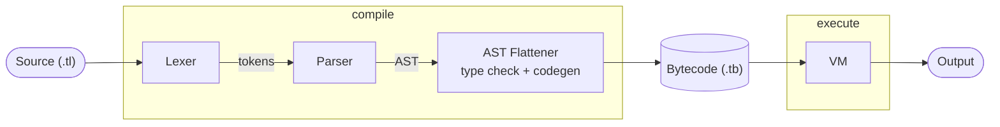

# Tiny Compiler VM

**A statically typed language with a bytecode compiler and virtual machine interpreter, written in Rust.**

## Contents

- [About](#about)
- [Features](#features)
- [Example](#example)
  - [Error messages](#error-messages)
- [Getting Started](#getting-started)
  - [Prerequisites](#prerequisites)
  - [Installation](#installation)
  - [Compile and run](#compile-and-run)
- [How It Works](#how-it-works)
  - [Project structure](#project-structure)
- [Design Decisions](#design-decisions)
- [Language Reference](#language-reference)
- [Limitations](#limitations)
- [License and Contact](#license-and-contact)

## About

I built this project both to learn about compiler design, and to deepen my understanding of the Rust language.

Programs are written in `.tl` source files, compiled to `.tb` bytecode files, and executed by the VM. Compiling and running are separate steps, so the bytecode can be reused after compiling.

## Features

* Classes with both static and instance-level members
* Inheritance and member overrides
* Fixed-length arrays
* Nullable types with safe access (`?.`), null coalescing (`??`), and non-null assertion (`!!`)
* Compile-time type checking
* VM validates code while running
* Errors that name the stage that failed

## Example

```
class Counter {
    int total = 0;
    fun void add(int n) { this.total = this.total + n; }
}

class Doubler : Counter {
    fun override void add(int n) { this.total = this.total + n * 2; }
}

Counter c = Doubler();
int[3] steps = [1; 2; 3];
for (int i = 0; i < 3; i = i + 1) {
    c.add(steps[i]);
}
print c.total;

Counter? missing = null;
print missing?.total ?? -1;
```

Output:

```
12
-1
```

`Doubler` overrides the inherited `add` method. The variable `c` is declared as a `Counter` but holds a `Doubler`, so `c.add(...)` runs the overriding version. That's why the total is 12 (2 + 4 + 6) rather than 6.

See the [Language Reference](#language-reference) for the full syntax.

### Error messages

Every error says which stage of the toolchain produced it. Lexical and syntax errors include a line and column. Semantic and runtime errors do not (see [Design Decisions](#design-decisions)).

**Lexical error**: the lexer rejects a malformed token.

```
int x = 5 & 3;
```
```
lexical error at line 1, column 11: expected '&&', found a single '&'
```

**Syntax error**: the parser finds a token that the grammar does not allow.

```
int x = 5
print x;
```
```
syntax error at line 2, column 1: expected ';', found 'print'
```

**Semantic error**: the program parses, but the type checker rejects it.

```
int x = "hello";
```
```
semantic error: 'x' is declared as 'int', but assigned a value of type 'string'
```

Some checks are done at compile time wherever they can be, for example a constant array index:

```
int[3] a = [0: 3];
print a[5];
```
```
semantic error: index 5 is out of bounds for array 'a' of length 3
```

**Runtime error**: the VM stops the program when it hits something the compiler could not rule out.

```
int[3] a = [0: 3];
int i = 5;
print a[i];
```
```
runtime error: index 5 is out of bounds for an array of length 3
```

## Getting Started

### Prerequisites

* A Rust toolchain, version 1.85 or newer (the project uses the 2024 edition). It can be installed using [rustup](https://rustup.rs)
* Git, to clone the repo ([downloads page](https://git-scm.com/install/))

### Installation

```bash
git clone https://github.com/Australiaisfake7/tiny-compiler-vm
cd tiny-compiler-vm
cargo build --release
```

### Compile and run

```bash
# Compile source
cargo run --release -- compile examples/01_hello.tl

# Run compiled bytecode
cargo run --release -- execute examples/01_hello.tb
```

Compiling `foo.tl` writes `foo.tb` next to it. Each mode checks the file extension (`.tl` to compile, `.tb` to execute) and reports a usage error if it does not match.

## How It Works



**Compilation**:

1. The lexer receives the source code as a string of characters. It then iterates through these characters and breaks them into chunks called tokens, stripping all whitespace and comments in the process.
2. The parser takes these tokens as input, and uses syntax rules to construct them into a tree of nested statements and expressions, called the abstract syntax tree or AST.
3. The AST flattener then receives this syntax tree, and traverses it to break it down into simple operations, called OpCodes. While doing so it type checks the program, so type errors are caught here, before anything runs.

**Execution**:

The execution phase consists only of the virtual machine, or VM. It reads a `.tb` file and executes its OpCodes one by one using a stack. It does not assume the bytecode is valid, and checks each operation as it runs.

### Project structure

```
src/
├── main.rs              Command line interface; reads and writes the .tl and .tb files
├── error.rs             Error types shared by every stage, plus the conventions they follow
├── builtin.rs           Built-in functions (input, parseInt, parseFloat) and their signatures
├── compiler.rs          Wires the stages together: lexer -> parser -> flattener
├── compiler/
│   ├── lexer.rs         Source characters -> tokens with positions
│   ├── parser.rs        Tokens -> AST (recursive descent)
│   └── ast_flattener.rs AST -> bytecode, with type checking and class layout
└── vm.rs                Bytecode interpreter and runtime errors
examples/                Example programs (.tl)
```

## Design Decisions

* **Classes and functions must be declared before use**: The compiler never has to look ahead, which simplifies its design and prevents circular references. However, mutually recursive functions and classes that reference each other are not possible. The same rule applies inside a class: a method can only call methods, and read fields, that appear above it in the class body.
* **Semantic errors do not carry position information**: The lexer and parser carry positional information, but the AST flattener does not. This keeps the flattener simpler, but its errors cannot say where in the source they occurred.
* **VM doesn't trust bytecode safety**: This prevents invalid bytecode from performing unsafe or invalid actions at runtime, however it carries the extra overhead of runtime checks.
* **Instances are compared by identity**: This allows for quick and simple equality checks but different instances with the same value are not equal. Arrays are the exception: they are compared by value, so equality with array literals works.
* **Function parameters and arguments are separated with ';'**: This is an unconventional syntax but is consistent with the separators in for loops, and avoids needing an extra ',' token to convey the same meaning.

## Language Reference

### Types

| Type | Description |
|------|-------------|
| `int` | 64-bit signed integer. Overflow is a runtime error. |
| `float` | 64-bit floating point number |
| `string` | Text. `+` joins two strings, `==` compares their contents, and `<` `<=` `>` `>=` compare them in order. |
| `bool` | `true` or `false` |
| `ClassName` | An instance of a class |
| `T?` | A nullable `T`, for example `int?` |
| `T[n]` | A fixed-length array, for example `int[3]`. Arrays can nest: `int[2][3]`. |
| `void` | Only valid as a function return type |

There are no implicit conversions, so `1 + 2.0` is a compile-time error.

### Literals and comments

```
42                      // int
3.14                    // float
5.                      // also a float (5.0)
"hello"                 // string
true  false  null
// a comment runs to the end of the line
```

* There are no block comments.
* A float literal is digits, a `.`, and optional digits. `.5` and exponent forms such as `1.5e3` are not valid.
* String literals have no escape sequences, so a string cannot contain `"`. A backslash is an ordinary character.
* A negative literal is the unary `-` applied to a positive one, so the smallest `int` (`-9223372036854775808`) cannot be written as a literal.

### Variables

Non-nullable variables must be initialized. Nullable variables start as `null` if no value is given.

```
int count = 0;
string name = "tiny";
int? maybe;                  // null
int[3] items = [1; 2; 3];    // array literal, elements separated by ';'
int[100] zeros = [0: 100];   // array fill: [value: length]
```

Declarations at the top level of the file are global and are visible inside functions declared after them. A local variable or parameter may reuse the name of a global, in which case it hides it. It may not reuse the name of another local in an enclosing scope, a function, or a class.

### Operators

From lowest to highest precedence:

| Operators | Notes |
|-----------|-------|
| `=` | Assignment to a variable, member or array element |
| `??` | Null coalescing: `a ?? b` is `a` unless `a` is `null` |
| `\|\|` | Logical or |
| `&&` | Logical and |
| `==` `!=` | Equality |
| `<` `<=` `>` `>=` | Comparison |
| `+` `-` | Addition and subtraction |
| `*` `/` `%` | Multiplication, division and remainder. Integer division truncates. |
| `!` `-` | Logical not and negation (prefix) |
| `()` `.` `?.` `[]` `!!` | Call, member access, safe member access, indexing, non-null assertion (postfix) |

* `a?.b` is `null` if `a` is `null`, otherwise `a.b`.
* `a!!` asserts that a nullable value is not `null`. It is a compile-time error on a non-nullable value, and a runtime error if the value is `null`.
* `%` works on `int` only. The result has the sign of the left operand, so `-7 % 3` is `-1`. Division or remainder by zero is a runtime error for `int`.
* `float` arithmetic follows IEEE 754 and never raises an error: `1.0 / 0.0` is `inf` and `0.0 / 0.0` is `NaN`.
* `!!` is always read as the non-null assertion, so a double logical not must be written with brackets: `!(!b)`, not `!!b`.

### Control flow

```
print value;                       // print is a statement, not a function

if (x > 0) { ... } else if (x < 0) { ... } else { ... }

while (condition) { ... }

for (int i = 0; i < 10; i = i + 1) { ... }
for (;;) { ... }                   // every part of the header is optional

break;
continue;
return value;
```

Braces are always required.

The compiler also rejects code that can never run. Any statement after a `return`, `break`, `continue`, or a loop that can never exit is a semantic error, and so is a function with a non-`void`, non-nullable return type that does not return on every path.

#### Printing

`print` writes one line. `int` and `bool` print as written, a `float` always shows a decimal point (`3.0`), a `string` prints without quotes, `null` prints as `null`, and an array prints as `[1, 2, 3]`. Printing an instance shows only its class's internal number, for example `instance of class 0`, because the bytecode does not store class names.

### Functions

The return type comes after `fun`. Parameters and arguments are separated by `;`.

```
fun int add(int a; int b) {
    return a + b;
}

print add(2; 3);
```

### Classes

Members are accessed through `this` inside methods. Instances are created with `ClassName()`, and a subclass replaces a method with `fun override`. Static members are accessed through the class name, and are also reachable through its subclasses.

```
class Animal {
    static int created = 0;
    string name = "animal";

    fun string sound() { return "..."; }
    static fun int total() { return Animal.created; }
}

class Dog : Animal {
    fun override string sound() { return "woof"; }
}

Dog d = Dog();
print d.sound();       // woof
print Animal.total();  // 0
```

Rules for overriding:

* An override must keep the same parameter types as the method it replaces. Its return type may be the same or a subclass of the original.
* A subclass cannot redeclare an inherited field or method without `override`, and `override` on a method that overrides nothing is an error.
* There is no `super`; an override cannot call the version it replaces.

Inside a class body, members are processed top to bottom. `this` is only available inside methods, not in a field's initializer, and a field initializer cannot refer to fields declared after it.

### Arrays

Array lengths are part of the type and are fixed at compile time. Indexing is checked: a constant index that is out of range is a compile-time error, any other bad index is a runtime error.

Arrays are references. Assigning an array, or passing it to a function, does not copy it; use `clone()` for an independent copy. Nested arrays are copied too.

```
int[2] a = [1; 2];
int[2] b = a;
b[0] = 99;                 // a[0] is now 99 as well
int[2] c = a.clone();
c[0] = 7;                  // a is unchanged
```

An array fill evaluates its value once. For nested arrays each element gets its own copy, but for class instances every element refers to the same object:

```
class P { int v = 0; }
P[2] q = [P(): 2];
q[0].v = 9;
print q[1].v;              // 9
```

### Built-in functions

| Function | Description |
|----------|-------------|
| `input()` | Reads a line from standard input, as a `string?`. The line ending is removed, and the result is `null` at end of input. |
| `parseInt(s)` | Parses an `int`, or returns `null` if `s` is not one |
| `parseFloat(s)` | Parses a `float`, or returns `null` if `s` is not one |

```
int? n = parseInt(input());
print n ?? -1;
```

Parsing does not trim whitespace, so `parseInt(" 5")` is `null`, while a leading `+` is accepted (`parseInt("+5")` is `5`). `parseFloat` also returns `null` for `inf` and `NaN`.

## Limitations

* No mutual recursion between functions, and no classes that refer to each other. Self-recursion works.
* A class cannot create an instance of itself from a static method or a static initializer, because its constructor is not defined yet at that point, so a static factory method is not possible. Instance methods can create instances of their own class.
* A method cannot call a method that is declared later in the same class.
* Classes have no constructor parameters; they are created with `ClassName()`.
* There is no `super`.
* Functions and classes cannot be declared inside another scope.
* Array sizes are written as integer literals, so they cannot depend on a variable.
* Semantic and runtime errors have no line and column.
* The operand stack holds 1,024 values and calls can nest 512 deep, so very deep recursion ends with a runtime error.
* Heap values are reference counted, so reference cycles between objects are never freed.
* Freeing a very long chain of objects (for example a linked list of several hundred thousand nodes) can overflow the native stack of the VM and abort it, because freeing happens recursively.
* Array sizes are not limited, and an array too large for memory aborts the VM with an out-of-memory failure instead of a runtime error.
* Extremely deep nesting in the source (for example hundreds of thousands of nested brackets) can overflow the compiler's own stack.
* `%` does not work on `float`.
* `!!` cannot be used as a double logical not (see [Operators](#operators)).
* Strings have no escape sequences, and numbers have no exponent notation.
* The `.tb` format has no header or version number, and does not store class names.
* A program is a single file; there are no imports.

## License and Contact

Distributed under the MIT License. See [LICENSE](LICENSE) for details.

GitHub: [Australiaisfake7](https://github.com/Australiaisfake7)