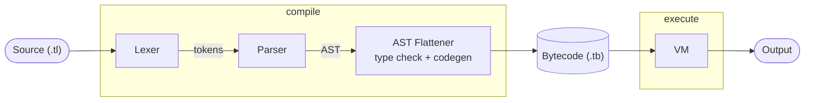

# Tiny Compiler VM

**A statically typed language with a bytecode compiler and virtual machine interpreter, written in Rust.**

## About

I built this project both to learn about compiler design, and to deepen my understanding of the Rust language.

## Features

* Classes with both static and instance level members
* Inheritance and overrides
* Fixed length arrays
* Nullable types
* Compile-time type checking

## Getting Started

### Prerequisites

Requires an installed Rust toolchain.
If you do not have Rust installed you can get an installer using [rustup](https://rustup.rs).

### Install & Build

Requires git installed. 
```bash
git clone https://github.com/Australiaisfake7/tiny-compiler-vm
cd tiny-compiler-vm
cargo build --release
```

### Run Project 

```bash
# Compile source
cargo run --release -- compile examples\01_hello.tl

# Run compiled bytecode
cargo run --release -- execute examples\01_hello.tb
```

## How It Works



The compiler takes a .tl source file and compiler it through the lexer parser and AST flattener into a .tb bytecode file. This bytecode can then be read and executed by the vm.

## Design Decisions

* **Classes and functions must be declared before use:** The compiler never has to look ahead, which simplifies its design and prevents circular references, howerer mutually recursive unctions and classes that reference each other are not possible
* **Semantic errors do not carry position information:** The lexer and parser carry positional information for their data, however the AST flattener does not. This simplifies its design but means its errors don't carry positional information.
* **VM doesn't trust bytecode safety:** This prevents invalid bytecode from performing unsafe or invalid actions at runtime, however it carries the extra overhead of runtime checks.
* **Instances are compared by identity:** This allows for quick and simple equality checks but different instances with the same value are not equal.


